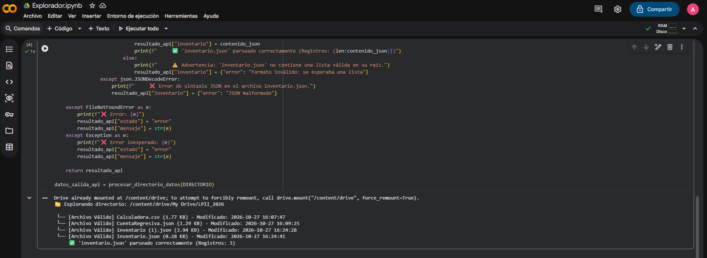

# Explorador de Datos en Google Drive

Módulo estructurado en Python enfocado en el uso de Google Colab para montar en Google Drive, el filtrado de archivos .csv y .json, la extracción de metadatos y la validación de esquemas JSON.

## Características Principales

- **Montaje seguro** de Google Drive en el entorno de Google Colab.
- **Filtrado selectivo** enfocado exclusivamente en extensiones `.json` y `.csv`.
- **Extracción precisa de metadatos**: Cálculo de tamaño en Kilobytes (`os.path.getsize`) y fecha/hora legible de última modificación (`os.path.getmtime`).
- **Parseo estructurado y validación**: Lectura segura del archivo `inventario.json` verificando que su estructura principal corresponda a una lista de registros.
- **Retorno normalizado**: Generación de un diccionario estructurado en memoria ideal para ser consumido por una API REST.

## Estructura

```
.
├── Explorador.ipynb
├── README.md
├── LICENSE
└── .gitignore
```

## Capturas de Prueba del Ejecutable




---

## Licencia
Este proyecto está bajo licencia abierta MIT. Consulta [LICENSE](LICENSE).